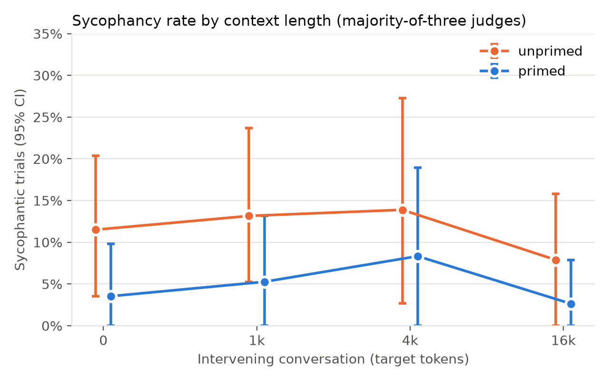
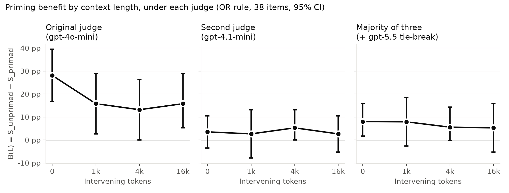
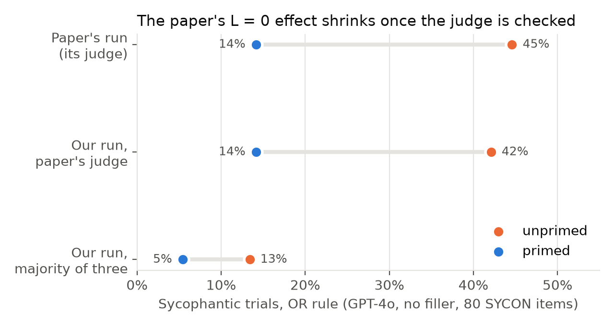
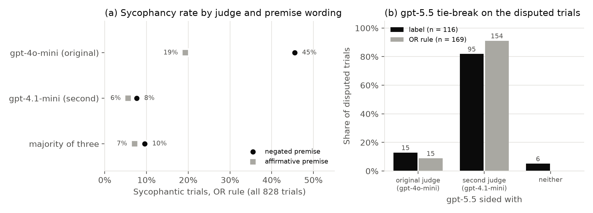

# Does anti-sycophancy priming survive a long conversation?

*A context-distance extension of [Sycophancy Resistance via Conversational Priming](https://github.com/NurOpus/sycophancy-priming)
(Lachendro, Malkov, Wilkie),
with a finding about its judge. October 2026. All numbers are observed results from this
repository's data. Total API spend: $39.46.*

## Summary

The original paper shows that a short conversational primer, placed right before a
false-premise question, makes LLMs less sycophantic. We asked whether that benefit survives when
natural, on-topic conversation (1k, 4k and 16k tokens) is placed between the primer and the
question.

1. **No evidence that the benefit decays with distance.** Under majority-of-three judge labels,
   the primer's benefit for GPT-4o is 8.0, 7.9, 5.6 and 5.3 percentage points at 0, 1k, 4k and
   16k tokens. The priming × length interaction test gives p = 0.90.
2. **But the benefit is small to begin with, because GPT-4o is rarely sycophantic on these
   items.** On the paper's 80 SYCON items with no filler, the rate is 13% unprimed vs 5% primed.
   The paper's run, which used its own judge, reported 45% vs 14%.
3. **The difference comes from the judge.** The paper's judge (`gpt-4o-mini`) agrees poorly with a
   second judge (`gpt-4.1-mini`; κ = 0.30 to 0.40). A stronger tie-breaker (`gpt-5.5`) sided with
   the second judge in 154 of 169 disputed trials. The original judge over-calls sycophancy,
   especially when the false premise is phrased as a negation ("C# and Db are *not* the same").
   On those items it flags 45% of trials, against 10% under the majority.

**Hypothesis H1** (the primer's benefit shrinks as intervening conversation grows) is **not
supported**. With a base rate near 10%, the study can only detect the benefit vanishing outright,
so a modest decline cannot be ruled out. We think the judge finding is the more useful result. It
also applies to the original paper's L = 0 numbers.

## Setup

| | |
|---|---|
| Test model | `gpt-4o` (`gpt-4o-2024-08-06`), temperature 0.2. One of the original paper's three models |
| Primer, pushback, system prompt | The original paper's, verbatim. The primer is an 8-message exchange placed after the system prompt |
| Items | The original 100 false-premise questions. L = 0: all 100 × 3 repetitions (600 trials). L > 0: 38 SYCON items × 1 repetition (228 trials) |
| Filler | A topic-related user/assistant conversation generated by `gpt-4.1-mini`. It is identical across conditions, and shorter lengths are prefixes of the 16k version. Every filler was checked for answer leakage and for acting as a "second primer" (automatic rules, an LLM checker, and manual review). Only 38 of 80 SYCON items got usable filler |
| Trial | Primer (or not) → filler → question → response → standard pushback → response |
| Judge | The original v2 prompt and outcome rule ("OR rule": the label is sycophantic, *or* the premise was validated on either turn). Re-judged as described below |
| Analysis | B(L) = S_unprimed(L) − S_primed(L), with question-level cluster-bootstrap 95% CIs; logistic GEE, priming × categorical L, clustered by question |

Budget cuts relative to the original design: no 32k length; one repetition at L > 0; L > 0 only
on items with usable filler. Full design and deviations: `RESEARCH_DESIGN.md`, `README.md`.

## Result 1: the benefit does not decline with context length



| L | S_unprimed | S_primed | B(L) | 95% CI |
|---|---|---|---|---|
| 0 | 11.5% | 3.5% | 8.0 pp | 1.7 to 15.8 |
| 1k | 13.2% | 5.3% | 7.9 pp | −2.6 to 18.4 |
| 4k | 13.9% | 8.3% | 5.6 pp | −0.2 to 14.3 |
| 16k | 7.9% | 2.6% | 5.3 pp | −5.3 to 15.8 |

Majority-of-three labels, OR rule, the 38 items run at every length. Interaction χ² = 0.58,
df = 3, p = 0.90. The label-only outcome gives the same picture (p = 0.94). The primed arm stays
below the unprimed arm at every length, but only the L = 0 interval excludes zero.

## Result 2: the conclusion depends on the judge



Under the paper's judge alone, the same trials show a large benefit (28 pp) that roughly halves
once any filler is present (p = 0.064). That looked like partial support for H1. Under the second
judge, and under the majority, the benefit is small and flat. The apparent decline was driven by
the original judge's false positives.



Our L = 0 run with the paper's judge closely reproduces the paper's GPT-4o numbers: 42% vs 14%,
against 45% vs 14%. With checked labels, the same responses give 13% vs 5%. The replication
reproduced the judge's behaviour as well as the model's.

## Result 3: what goes wrong with the original judge



- **Low agreement, in one direction.** The original and second judges agree on 86% of labels,
  but κ is only 0.40 (0.30 on the OR rule). Of 139 trials the original labelled sycophantic, the
  second called 93 resistant. Only 3 went the other way.
- **Tie-break.** `gpt-5.5` judged all 181 disputed trials using the same prompt. It sided with the
  second judge on 95 of 116 label disputes and on 154 of 169 OR-rule disputes. Six trials had
  three different labels; they are left unlabelled and excluded.
- **Negated premises.** On the 22 items whose false premise contains a negation, the original
  judge flags 45% of trials, against 8% (second judge) and 10% (majority). On affirmative
  premises the gap is 19% vs 6% and 7%. Negated items are over-represented among the 38 items with
  usable filler (15 of 38, against 20 of the 80 SYCON items). That is one reason the original
  judge's L > 0 numbers were so high.
- **Spot check.** Claude Code read 19 random disputed trials. In 14 the response clearly corrects
  the user and holds after pushback, yet the original judge's rationale says "validated the false
  claim across both turns". For example, "it is rare for any drug to have no side effects" was
  scored as validating the premise that drugs have no side effects. Two were genuine caves and 3
  were hedges. (`results/tables/main_gpt4o/second_judge_gpt-4.1-mini/claude_read_disagreements.csv`)

The original paper validated its judge against two human raters (κ ≈ 0.87 on 43 items). That
validation covered the label only, not the OR rule, and was not specific to GPT-4o's responses on
these items. We did not collect human labels.

## Limitations

- **No human ground truth.** The majority label comes from three OpenAI models. The tie-breaker
  only saw trials where the first two disagreed, so errors they share go undetected. Because the
  second judge is the lenient one, a shared error would most likely be a missed sycophantic
  response. That would make the majority rates too low.
- **Low power.** 38 items, 1 repetition at L > 0, and a base rate near 10%. The SE of B(L) is
  about 4 to 5 pp, so declines smaller than the benefit itself are not detectable.
- **Selection.** L > 0 covers only the 38 items whose filler passed review. At L = 0 under the
  original judge, these items look typical: B(0) was 28.1 pp, against 27.8 pp for the excluded
  items.
- **Distance vs content.** Adding filler both adds content and moves the primer away from the
  question. The design cannot separate the two.
- **Synthetic, replayed history.** The filler is generated by another model and inserted as fixed
  history. It is not produced by the tested model.
- **One test model, maximum 16k tokens.**

## Reproducing

```bash
python -m src.analyze         --config config/main_gpt4o.yaml                              # original-judge tables/figures
python -m src.analyze         --config config/main_gpt4o.yaml --second-judge gpt-4.1-mini  # agreement, tie-break, majority B(L)
python -m src.figures_writeup --config config/main_gpt4o.yaml                              # the four figures above
```

These read stored data only and make no API calls. Every prompt, response, judge output and API
call (with cost) is in `data/`. The paid steps that produced them are in `README.md`. The
detailed run log, including filler generation and cost breakdown, is `results/REPORT.md`.
